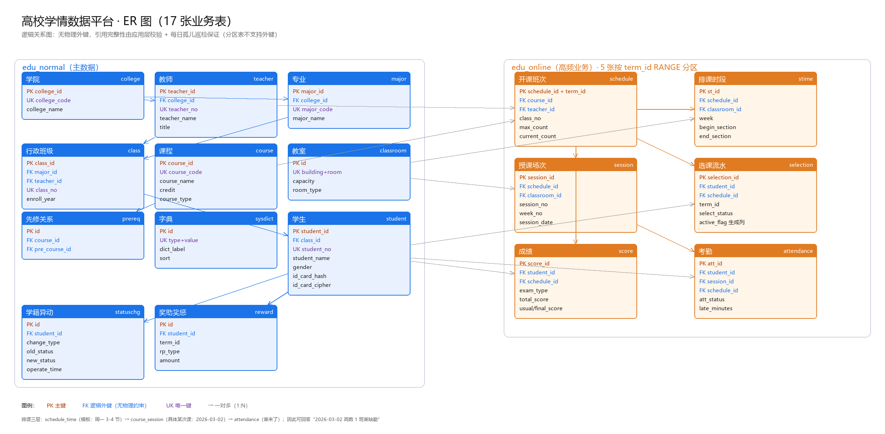

# 高校学情数据平台（MySQL 四层数仓 + Hive 迁移验证）

面向教务管理的学情数仓项目：把 **19 张业务表（约 290 万行）** 加工成 **8 类可交付指标**，
支撑挂科分析、学业预警、教师工作量评估等业务场景；并完成 **MySQL → Hive 4.0** 的迁移验证。

> 所有数据由脚本生成，**不含任何真实个人信息**。

---

## 架构

```
业务库(OLTP)          ODS              DWD                    DWS              ADS
19 张业务表    →   17 张贴源表   →   10 维度 + 3 事实   →   4 张主题宽表   →   8 张指标表
约 290 万行        全字符串            清洗/星型/拉链表        口径固化           业务直查
                                      ↓
                            Hive 4.0 迁移验证（4 张外部表 / 97.5 万行）
```



## 数据规模

| 层 | 表数 | 行数 |
|---|---|---|
| 源库（OLTP） | 19 | 约 290 万 |
| ODS | 17 | 2,894,927 |
| DWD | 15（10 维 + 3 事实 + 1 成绩宽表 + 1 拉链） | 约 290 万 |
| DWS | 4 | 62,280 |
| ADS | 8 | 约 10,245 |
| Hive（外部表） | 4 | 975,327 |

核心明细规模：选课 48 万 · 成绩 47 万 · 考勤 192 万 · 学生 2 万 · 班次 720。

## 目录结构

```
edu-dw-platform/
├─ sql/          # 20–95 号脚本：造数 → ODS → DWD → DWS → ADS → 质量 → 优化 → 增量
│  └─ patch/     # 10–16 号：建表阶段的方案改造与修复脚本（历史留档）
├─ hive/         # Hive 4.0：外部表 DDL、导出、装载、聚合对账、倾斜实验
├─ nl2sql/       # 自然语言取数（Text2SQL）：语义层 + 评测集 + 结果校验
├─ docs/         # 项目总览、ER 图与范式论证、数据字典、四份实验报告
└─ scripts/      # 生成 ER 图（Pillow）与数据字典（openpyxl）的辅助脚本
```

## 快速开始

### 1. 准备 MySQL

本项目在 **MySQL 26.10**（端口 **3307**）上验证，MySQL 8.0+ 均可运行。
需要三个库：`edu_normal` / `edu_online` / `edu_dw`。

### 2. 按编号顺序执行 `sql/` 下的脚本

| 顺序 | 脚本 | 作用 |
|---|---|---|
| 1 | `20_造数_1_工具与维表.sql` | 数字表 + 8 张维表 |
| 2 | `21_造数_2_业务数据.sql` | 班次、课次、选课、成绩、考勤、异动 |
| 3 | `22_重灌事实表_修正分布.sql` | 修正成绩分布（可选） |
| 4 | `30–33` | ODS 层：17 张贴源表 + 三字段对账 |
| 5 | `40_ODS注入脏数据.sql` | 注入 9 类脏数据（用于验证清洗逻辑） |
| 6 | `50–53` | DWD 层：维度、事实、质量规则、拉链表 |
| 7 | `54_DWS_主题宽表.sql` | DWS 层：4 张主题宽表 |
| 8 | `60_ADS_指标层.sql` | ADS 层：8 张指标表 |

```bash
mysql -h 127.0.0.1 -P 3307 -u root -p < sql/20_造数_1_工具与维表.sql
```

> ⚠️ 脚本里的连接信息请按自己环境修改；`hive/export_ods.bat` 的密码通过环境变量 `MYSQL_PWD` 传入。

### 3. Hive 部分

参考 [`docs/阶段4-Hive迁移验证报告.md`](docs/阶段4-Hive迁移验证报告.md)：
用 Docker 起 `apache/hive:4.0.0`，执行 `hive/01_ddl.sql` 建 4 张外部表，
`export_ods.bat` 导出 TSV → `03_load.sql` 装载 → `04_aggregate.sql` 对账 → `05_skew.sql` 倾斜实验。

---

## 关键设计

| 设计 | 说明 |
|---|---|
| **ODS 全字符串贴源** | 数值字段一律 VARCHAR，`-5` / `150` / `缺考` 都能进仓，不因类型报错丢行 |
| **DWD 星型建模 + 拉链表** | 学生学籍 SCD2 拉链表 28,000 段，支持任意历史时点回溯 |
| **未知成员 -1 + 有效性标记** | 脏外键不丢行；`is_valid` + `invalid_reason` 让无效数据可追溯 |
| **生成列实现"部分唯一索引"** | `active_flag` 生成列 + NULL 不参与唯一性，解决"仅一条有效选课 + 退课可重选" |
| **DWS 口径固化** | 均分取最高分（学生权益）、挂科按正考（教学评估），双口径并存 |
| **11 条数据质量规则** | 发现 1,687 条问题，通过率 99.98%，规则结果落库 `dq_result` |
| **增量抽取 + 幂等写入** | `updated_at` 水位线增量（仅处理 0.006% 数据）+ `ON DUPLICATE KEY UPDATE` 幂等 |

## 实验结果

| 实验 | 结果 | 详见 |
|---|---|---|
| **慢查询优化** | 函数失效 1.557s → **0.11ms**（扫描 192 万 → 96 行）；深分页改游标 1.059s → **0.55ms**；覆盖索引 2.706s → **0.389s** | [docs/阶段3](docs/阶段3-索引优化报告.md) |
| **并发选课压测** | 500 并发：同一学生重复选课 `current_count` 只 +1；500 人抢 150 名额**零超卖零重复** | [docs/阶段2](docs/阶段2-并发选课压测报告.md) |
| **Hive 迁移** | 4 张外部表 / **97.5 万行**入仓，行数 **4/4 完全一致** | [docs/阶段4](docs/阶段4-Hive迁移验证报告.md) |
| **Hive 对账** | 聚合结果 3/4 学期一致；1 行差异定位为 **`CAST` 语义差异**（`'缺考'` → 0 vs NULL） | 同上 |
| **数据倾斜** | 构造 400 倍热点 key，对比 `skewindata` 与加盐两阶段；实测 20 万行量级下倾斜优化反而慢 38% | 同上 |
| **增量与幂等** | 增量仅处理 **0.006%** 数据（9.3s → 0.3s）；重跑内容指纹完全一致；迟到数据用分区覆盖补偿 | [docs/阶段5](docs/阶段5-增量抽取与幂等写入实验.md) |
| **Text2SQL 语义层** | 同一批 20 题、同一模型，仅补充语义层（口径/枚举值）：执行成功率 **75%→100%**、结果一致率 **60%→85%**；A 组 71% 的执行错误源于缺少 `term_id` 枚举语义 | [nl2sql/REPORT.md](nl2sql/REPORT.md) |

## 交付物

- `docs/` 下的四份实验报告 + ER 图 + 数据字典（33 张表 / 401 字段 / 161 索引）
- 全套可执行 SQL（42 个文件）
- ER 图与数据字典的生成脚本

## 说明

- 数据全部由 SQL 脚本生成（数字表交叉连接 + CRC32 伪随机），无真实个人信息
- 本项目按设计**不建物理外键**（分区表不支持 + 大表写入性能），引用完整性由应用层校验与质量规则保证
